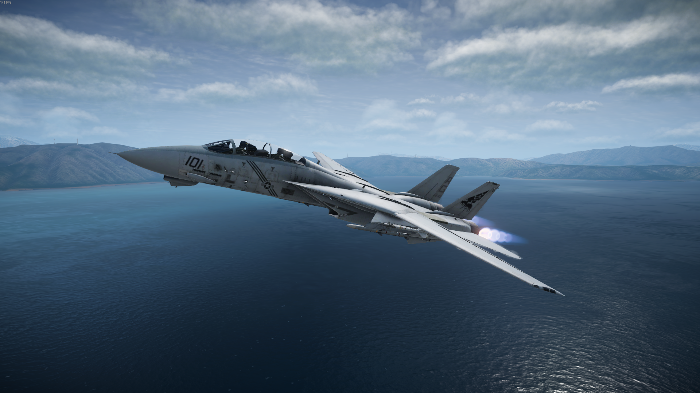
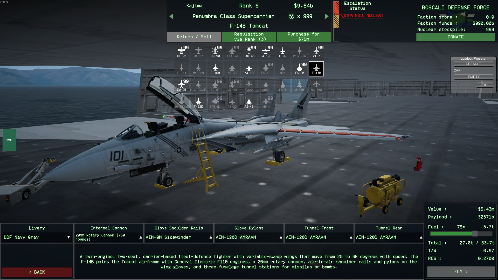

# F-14B Tomcat for Nuclear Option

A US Navy F-14B Tomcat for Nuclear Option. It is built with the Blueprinter framework, plus a BepInEx plugin for the systems that Blueprinter can't do on its own (spoilers, carrier gear, structural stiffening and more). The flight model is based on real F-14B figures, then tuned for Nuclear Option with a War Thunder-style game feel: a little stronger than the real jet, but not overpowered.

**Current release:** `F-14B Tomcat_0.1.9.nobp` + `F14B.Systems.dll` 0.1.9

> 3D model: "F-14B Tomcat with AIM-54 Phoenix" by **Jeyhun1985** on Sketchfab, CC BY 4.0 (see [CREDITS.md](CREDITS.md)).

**Download:** grab the files from the [latest release](https://github.com/SirKajima/NO-F-14B-Tomcat/releases/latest), or from the [`release/`](release/) folder of this repo.

---

## Installation

You need BepInEx and the Blueprinter mod already installed.

1. Delete any older `F-14B Tomcat_*.nobp` from your `BepInEx\plugins` folder (and its subfolders). Two versions at once will conflict.
2. Copy these from the `release/` folder into `Nuclear Option\BepInEx\plugins\` (a subfolder such as `plugins\F14B\` is fine):
   - `F-14B Tomcat_0.1.9.nobp`
   - `F14B.Systems.dll`
3. Start the game. The Tomcat appears in the hangar aircraft list.
4. Optional, with [Aryx's FS-41 Eclipse](https://github.com/Aryx3D/Aryx-s-FS-41-Eclipse) mod: the Tomcat can spawn on the **Penumbra Class Supercarrier** and the **Helion Class Carrier** and use their catapults. Put `release/F14B.catapults` in `BepInEx\plugins\com.nikkorap.blueprinter\addons\aryx.fs41\`. In multiplayer **every player** needs this file, not just the host: each player's own game runs their catapult launch. See [Compatibility](#compatibility-with-other-mods-optional-soft-dependencies) for how to launch and trap.
5. Optional, for bug reports: `release/F14B.FlightDebug.dll` (flight recorder, see below).
6. Optional, with [kingwixly's **Multi-Missile**](https://github.com/kingwixly/Multi-Missile/) mod (1.5.0): its missiles and bombs appear on the Tomcat's stations automatically. Nothing extra to install. Without Multi-Missile the Tomcat works as before.

The jet flies without `F14B.Systems.dll`, but you lose everything marked **[plugin]** below, including the structure fix that stops the wings bending and shaking at high speed. In multiplayer, every player flying the Tomcat should have the same files.

**Works alongside the F/A-18C Hornet mod.** Both plugins patch the game's wheel code; the F-14 plugin chains onto the Hornet's, so both jets keep their carrier deck fixes.

---

## Compatibility with other mods (optional, soft dependencies)

Neither mod below is required. The Tomcat has no hard reference to them: if one is missing, the game simply loads without that feature (Blueprinter logs a harmless "not found" line and skips it).

### Aryx's FS-41 Eclipse: Penumbra Class Supercarrier (and Helion Class Carrier)

[Aryx's FS-41 Eclipse](https://github.com/Aryx3D/Aryx-s-FS-41-Eclipse) adds the **Penumbra Class Supercarrier** and the **Helion Class Carrier**, with working catapults and arresting wires.

**Setup**
1. Install Aryx's FS-41 Eclipse (and Blueprinter, which it needs).
2. Copy `release/F14B.catapults` from this repo into `Nuclear Option\BepInEx\plugins\com.nikkorap.blueprinter\addons\aryx.fs41\`. This file tells Aryx's catapult where the Tomcat's nose wheel is. Without it the Tomcat can still spawn on the carrier, but the catapult won't grab it.
3. **Multiplayer: every player flying the Tomcat needs `F14B.catapults`**, not just the host. Each player's catapult launch runs in their own game.

**Spawning on the carrier**
- The Tomcat is added to the carrier's fixed-wing hangars: Penumbra `Hangar_F_01`, `Hangar_F_02`, `Hangar_F_R_01` and Helion `Hangar_F`.
- In a mission with a Penumbra (or Helion) on your side, pick the carrier as your spawn point and choose the Tomcat from the aircraft list.

**Catapult launch**
1. Taxi slowly to a catapult. The HUD shows the catapult overlay and **Clutch distance**. Line the nose wheel up on the catapult track.
2. **Slow down** and **hold the wheel brake**. The catapult engages ("Catapult engaged – Aligning aircraft") and pulls the jet into position.
3. Wait for "Catapult spooling up", then **"Catapult ready – Throttle up"**: go to full throttle (afterburner recommended).
4. After the countdown the catapult fires. It releases at about **165 kt** with about **4.5 g**. Pulling the throttle back before launch cancels it ("Throttle up to resume").

**Arrested landing (tail hook)**
- The tail hook is built in: it **lowers by itself** on approach (below about 190 kt, between 100 and 400 ft, descending). You don't need a key.
- Gear down, flaps out, and fly a stable approach at about **135–145 kt with the wings forward and flaps out** onto the angled deck. Aim for the wires and don't flare; carrier landings are meant to be firm.
- The hook catches a wire and stops the jet. The nose drops firmly onto the deck, as on the real jet; the plugin stiffens the nose strut while you're on the wire so it survives. The hook goes back up once you've stopped.
- If you miss the wires (a bolter), go to full power and fly off the angled deck for another try.

### kingwixly's Multi-Missile

[kingwixly's Multi-Missile](https://github.com/kingwixly/Multi-Missile/) adds real-world missiles and bombs, including the **AIM-120D AMRAAM**, **AIM-9X / AIM-9M Sidewinder** and **JDAMs** (500, 1,000 and 2,000 lb).

**Setup:** install Multi-Missile (it needs Blueprinter). That's all; there's nothing extra to copy. Its weapons appear in the Tomcat's loadout menu on the stations that already carry the same kind of store.

**Using them:** in the hangar, click a station in the loadout bar at the bottom (for example *Glove Shoulder Rails*) and pick the Multi-Missile weapon from its list. Fire them like any other weapon. The AIM-120D is radar-guided (lock and fire), the AIM-9s are heat-seekers, and JDAMs are GPS bombs dropped on a target you've selected.

| Station | Multi-Missile weapons |
|---|---|
| Glove Shoulder Rails | Single **AIM-120D**, **AIM-9X / AIM-9M**, AIM-9Z, IRIS-T, Meteor, R-27ER, K-30, SACM |
| Glove Pylons | **AIM-120D** (single, double), **AIM-9X / AIM-9M** (single, double, triple), AIM-9Z, IRIS-T, Meteor, R-27ER, K-30, SACM (up to 4) |
| Tunnel Front and Tunnel Rear | All the air-to-air racks above, plus **JDAM** 500 lb (1–3), 1,000 lb (1–2), 2,000 lb, and GBU-39 and GBU-53 quads |

- Multi-Missile's rack and missile shapes are its own. The plugin stops them from damaging the Tomcat when it spawns, even where a rack touches a neighbouring part (setting `MountSelfCollisionFix`, on by default).
- **Multiplayer:** every player needs Multi-Missile and the same Tomcat files.

---

## Highlights

### Aircraft and visuals
- Detailed 3D model with working moving parts:
  - **variable-sweep wings**, 20° to 68°
  - all-moving stabilators, twin rudders, trailing-edge flaps
  - **leading-edge slats** that run forward and down, opening a slot over the wing (and showing the red slat wells) **[plugin]**
  - **spoilers** that move for roll, ground lift-dump and approach control **[plugin]**
  - beaver-tail speedbrakes (upper and lower panels)
  - canopy
  - landing gear that folds exactly into the bays, with animated gear doors and the nose-gear actuator piston
  - whole wheels spin, tyre, rim, hub disc and spokes, while the legs and forks stay still
- **Two-crew cockpit:** pilot and RIO sit in the model's own ejection seats.
- **Ejection seats** for both crew, with canopy jettison.
- **Afterburner** glow and flame sized to the F-14's real nozzles.
- Boarding ladder on the left side when parked, navigation lights at the wingtips.
- Livery: **Navy Gray** (BDF and PALA).
- **Weapons:**
  - internal 20 mm rotary cannon
  - glove shoulder rails (air-to-air missiles)
  - glove pylons (air-to-air missiles)
  - tunnel stations under the fuselage, one front and two rear (air-to-air missiles and bombs)

### Swing wing
- **Automatic sweep:** wings fully forward up to about Mach 0.70 and fully back by about Mach 0.98, at 18°/s.
- **Manual sweep:** bind **Custom Axis 1** to control the sweep yourself.
- **Sweep gauge** on the HUD with an F-14 outline that moves with the wings, plus the "WING xx°" readout.
- **[plugin]** Holding *Axis Modifier* while moving the throttle no longer switches the wings to manual by accident (that used to leave the wings stuck swept back after using the airbrake).

### Slats [plugin]
- **Takeoff and landing:** the slats come out to 17° together with the flaps.
- **Maneuvering slats:** in the air below Mach 0.85 with the wings at 50° sweep or less, the slats come out to 7° by themselves as angle of attack rises (7.5–10.5°), like the real F-14's maneuver devices.
- **Stall protection:** at very high angle of attack below Mach 0.5 they run out toward the full 17°.
- **Lift:** with the slats out the wing keeps its airflow attached at high angle of attack, so it makes extra lift from about 8° to 16° angle of attack (with a little extra drag). Slower approaches and tighter low-speed turns.
- Swept back past 50° or above Mach 0.85, the maneuvering slats stay in.

### Spoilers [plugin]
- **Roll spoilers:** rise on the down-going wing for extra roll, like the real jet, while the wings are swept less than 57°. Above that, roll comes from the stabilators only.
- **Ground spoilers:** all spoilers pop up after touchdown with the throttle at idle (lift dump and drag). Pushing the throttle up retracts them, so a bolter or touch-and-go is unaffected.
- **Direct Lift Control:** on approach (gear down, flaps out) the spoilers sit slightly raised and move with the stick, for small, quick glideslope corrections.

### Flight model (game feel)
Based on real F-14B data, tuned to feel right in Nuclear Option. Figures marked "model" are what the tuning aims for and have not been measured in game.
- **g:** 8 g fly-by-wire limit, angle-of-attack limiter at 27°.
- **Engines:** two F110s, 256 kN total in full afterburner (about 0.9 thrust-to-weight fully fuelled).
- **Top speed:** about Mach 1.2 at low level (model; transonic wave drag added in 0.1.5).
- **Takeoff:** flaps stay fully down through rotation; lift-off about 150 kt (model).
- **Airbrake:** about a fifth of its 0.1.4 strength, for steady deceleration rather than a wall.
- **[plugin] Structure assist:** the game builds aircraft from separate parts held by physics joints, which made the wings bend like a bird's and flutter (fine 6 Hz shaking) at high speed. The plugin holds the wing, tail and engine sections rigid against each other. It uses equal and opposite forces, so it adds no lift, thrust or drag.

### Carrier operations
- Catapult launches and arrested landings on Aryx's carriers (see Installation, step 4). The catapult locks onto the bottom of the nose wheel, releases at about 165 kt and accelerates at 4.5 g.
- **Working tail hook:** lowers by itself on approach, catches arresting wires, and goes back up when you stop. **[plugin]** The game's AI and airbase list also treat the Tomcat as hook-equipped.
- **[plugin] Carrier-strength gear:** stiffer main and nose struts for no-flare deck landings.
- **[plugin] Nose drops onto the deck on the wire:** most of the real nose-down pitch from the arrest is kept, and the nose strut stiffens while you are on the wire so it survives the slam.
- **[plugin] Wheel contact safety net:** if a wheel's ground check ever misses the deck, it checks again from higher up (and across both nose wheels), so the nose wheel doesn't sink into the deck and lose steering.

### Damage
- **Break-apart:** wings, tails, control surfaces and engine sections are separate parts that can be shot or torn off.
- **Damage display:** the HUD diagram (bottom right) uses an F-14 silhouette with every part outlined. It shows when you spawn and when you are hit, then fades out like the stock jets.

---

## Plugin settings
Edit `BepInEx\config\f14b.systems.cfg` (created after the first launch):

| Section | Setting | What it does |
|---|---|---|
| Slats | `Slats` | Leading-edge slats on/off (17° with the flaps) |
| Slats | `ManeuverSlats` | Automatic 7° maneuvering slats by angle of attack, and stall protection |
| Slats | `SlatLiftArea` | Extra lift with the slats out at high angle of attack (default 4 m², both wings) |
| Spoilers | `RollSpoilers` | Roll spoilers on/off |
| Spoilers | `SpoilerMaxSweep` | Sweep (deg) above which the roll spoilers lock down (default 57) |
| Spoilers | `GroundSpoilers` | Lift dump and drag after touchdown with the throttle at idle |
| Spoilers | `GroundSpoilerDragArea` | Ground spoiler drag (default 2 m²; lift dump is 3× this) |
| Spoilers | `DirectLiftControl` | Approach glideslope control with the spoilers |
| Spoilers | `DLCStrength` | Strength of the DLC lift change (default 1) |
| Structure | `StructureAssist` | Keeps the wings and tail rigid (no bending, no high-speed shaking) |
| Structure | `SolverIterations` | Physics solver passes for the F-14's parts (default 30) |
| Structure | `JointDamping` | How strongly flutter between parts is damped (default 0.25) |
| Structure | `JointStiffness` | How strongly bending between parts is pulled back (default 0.08) |
| Flight | `WaveDragArea` | Extra drag through Mach 1; sets the top speed (default 0.6 ≈ Mach 1.2 at low level) |
| Wing Sweep | `BlockModifierThrottleSweep` | Stops Axis Modifier + Throttle from switching the wings to manual |
| Carrier | `TailHook` | Tells the game the Tomcat has a tail hook |
| Carrier | `ArrestPitchRelief` | How much of the wire's nose-down pitch is removed: 0 = full real slam, 1 = nose stays level (default 0.15) |
| Carrier | `CarrierGear` | Carrier-strength main and nose struts |
| Carrier | `ArrestNoseGear` | Nose strut stiffens while on the wire |
| Carrier | `GearContactProbe` | Wheel contact safety net on decks |
| Carrier | `GearDiagnostics` | Writes a log line when the safety net steps in (for bug reports) |
| Weapons | `MountSelfCollisionFix` | Weapons hung on the jet (any mod's, e.g. Multi-Missile) never collide with the jet's own parts, so they can't damage it at spawn (default on) |
| Weapons | `MountCollisionLog` | Writes a log line for every weapon mount the fix is applied to (for bug reports, default off) |

If the jet ever behaves strangely after part of it is shot off, try `StructureAssist = false` and report it.

## Flight recorder (optional, `F14B.FlightDebug.dll`)
Records each sortie for bug reports: one folder per flight in `BepInEx\F14B_Debug\`, with an event log (takeoff, landing, gear, strikes, damage, high g, sweep, arrests) and a 10 Hz telemetry table. **F8** marks a moment ("something felt wrong here"), **F9** shows or hides the live overlay. Settings: `BepInEx\config\f14b.flight.debug.cfg`. When reporting a bug, send the session folder, plus `BepInEx\LogOutput.log` for anything gear or carrier related.

---

## Changelog

### 0.1.9 (plugin 0.1.9)
- **[plugin] Weapons no longer damage the jet at spawn.** Some Multi-Missile racks have solid collision shapes that reach into a neighbouring part of the Tomcat (the glove cheeks from the glove pylons and shoulder rails; the fuselage, engines and gear bays from the tunnel stations). The game pushed the parts apart when the jet spawned, which damaged them. Weapons hung on the Tomcat now ignore collisions with its own parts; they still hit the ground, other aircraft and bullets normally. Works for any mod's weapons (setting `MountSelfCollisionFix`, on by default). Multi-Missile weapons need this plugin version.
- **Multi-Missile compatibility** (optional; needs kingwixly's Multi-Missile 1.5.0). Its weapons go on the stations that already carry the same kind of store:
  - **Glove shoulder rails:** single air-to-air missiles (AIM-9X/9M/9Z, IRIS-T, K-30, AIM-120D, Meteor, R-27ER, SACM).
  - **Glove pylons:** all external air-to-air racks (single to triple, SACM quad).
  - **Tunnel front and rear:** all external air-to-air racks plus JDAMs (500, 1000 and 2000 lb) and GBU-39 and GBU-53 quads.
  - No air-to-ground missiles, because no F-14 station carries any in the base game either.

### 0.1.8 (plugin 0.1.8)
- **Working leading-edge slats.** They are separate moving parts now: forward and down on their tracks, opening a slot over the wing.
  - 17° with the flaps for takeoff and landing.
  - 7° automatic maneuvering slats by angle of attack (wings at 50° sweep or less, below Mach 0.85).
  - Stall protection out to 17° at very high angle of attack below Mach 0.5.
  - Extra lift at high angle of attack while they are out.
- Damage display, collision shapes and the sweep gauge include the slats.

### 0.1.7
- **Damage display** now fades out like the stock jets; it only shows at spawn and when you take damage.
- **Wheels:** the hub discs, spokes and bolts now spin with the tyres on all wheels (both nose wheels and both mains).

### 0.1.6 (plugin 0.1.6)
- **Aryx supercarrier support:** catapult file `F14B.catapults`; the Tomcat spawns in the Penumbra and Helion fixed-wing hangars.
- **Carrier-strength gear:** stiffer main struts (1.5 MN/m) and nose strut (600 kN/m), more damping.
- **Arrested landings:** the nose now drops hard onto the deck when the hook catches, and the nose strut stiffens on the wire so it survives.
- **Deck taxiing:** wheel contact safety net so the nose wheel can't sink into the deck and lose steering (same fix as the Hornet; works with the Hornet plugin installed).
- **RIO** seated 11 cm lower; his helmet no longer pokes through the canopy.

### 0.1.5 (plugin 0.1.5, recorder 0.1.3)
- **High-speed shaking and wing flex fixed.** The 6 Hz "micro shake" was flutter in the joints between the wing sections. Fixed with the new structure assist, more weight in the wing sections (total weight and centre of gravity unchanged) and slightly softer fly-by-wire gains.
- **Damage display:** the white box covering it is gone.
- **Sweep gauge** shows an F-14 outline instead of the AB-4's.
- **Airbrake** about 5× weaker.
- **Wing sweep:** faster (18°/s), and Axis Modifier + Throttle no longer locks the wings in manual sweep after using the airbrake.
- **Top speed** brought down to about Mach 1.2 at low level (it reached Mach 1.38).
- **Takeoff:** flaps stay fully down until about 175 kt, so they're out at rotation.
- **Taxi:** nose strut damping raised to stop the nose bobbing when braking.
- **Wheels:** rims and hubs spin with the tyres.
- **Pilots** moved forward into the model's own seats (they sat behind the headrests).
- Recorder: no more false "gear lost" warning when the gear retracts.

### 0.1.4 (new plugin `F14B.Systems.dll` 0.1.4, recorder 0.1.2)
- **Game-feel flight model:** new sweep schedule, lift areas, flaps, 8 g fly-by-wire, +7 % thrust (256 kN in afterburner).
- **Main gear** folds exactly into the bays (combined twist-and-slide retraction); front and rear main gear doors close the bay fully.
- **Spoilers:** roll, ground lift-dump and Direct Lift Control **[plugin]**.
- **Sweep gauge** added to the HUD.
- **Ejection seats** for both crew with canopy jettison (replaces the AB-4's whole-cockpit escape capsule and its magenta rocket flame).
- **Damage display** redrawn as an F-14 silhouette, with the engine fire lamps on the correct nacelles (1–2 left, 3–4 right).
- **Working tail hook.**
- **Rudders** no longer shake (they were hanging on a flexible tail-fold joint).
- **Afterburner** glow fitted to the real nozzles, longer flame.
- Main wheels no longer wobble (spin centre corrected); the left main wheel no longer breaks off on grass.
- Weapon fixes on the glove rails and the front tunnel station; boarding ladder and nav lights placed.

### 0.1.3 (recorder 0.1.1)
- **Tail strikes fixed:** collision shapes now follow the real fuselage; the tail clears the ground up to about 11.9° of pitch.
- **Gear height** corrected (the jet sat 12 cm too low) and the nose strut strengthened (it broke on landing).
- **Nose gear doors** and the **nose actuator piston** now animate; main gear doors added.
- **Weapons** placed at the real F-14 stations: glove shoulder rails, glove pylons, front and rear tunnel stations.

### 0.1.1 – 0.1.2
- **Landing gear rebuilt** from the real station diagram: main wheels straight, struts vertical, the jet sits level. The main gear piston slides with the suspension.
- Gear retraction set up (fold forward and up, with the main legs twisting to lie flat).

### 0.1.0
- First build: F-14B model on the AB-4 Alkyon swing-wing rig, swinging wings, flaps, stabilators, rudders, speedbrakes, canopy, gear, internal cannon and missile stations, Navy Gray livery.
- Flight recorder plugin (`F14B.FlightDebug.dll`) for bug reports.

---

## Credits
- 3D model: "F-14B Tomcat with AIM-54 Phoenix" by **Jeyhun1985** on Sketchfab, licensed **CC BY 4.0**. The model was modified for this mod (see [CREDITS.md](CREDITS.md)).
- Built with the **Blueprinter** framework for Nuclear Option, plus BepInEx and Harmony.

---

## Source code and licence

This mod is open source. The plugin source, the Unity (Blueprinter-Editor) mod folder and the editor tooling are in this repo; see [docs/BUILDING.md](docs/BUILDING.md). Code and project files: [MIT](LICENSE). 3D model and textures: CC BY 4.0, see [CREDITS.md](CREDITS.md).
